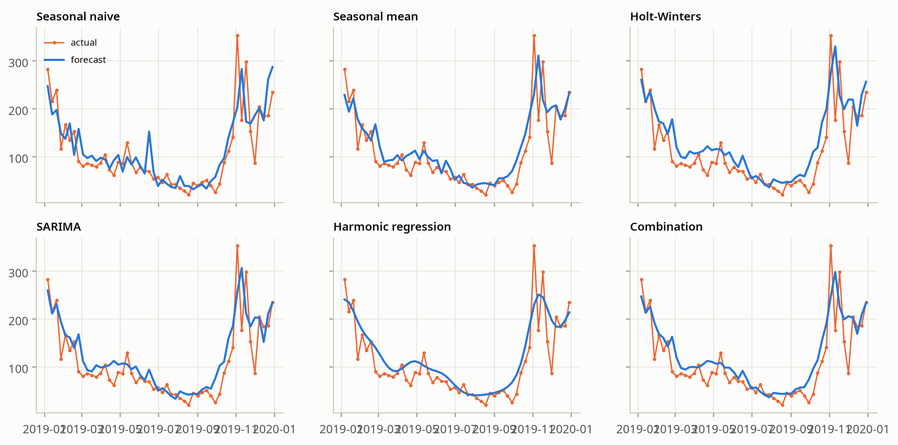

# Delhi PM2.5: Seasonal Models, Weather and a Year-Ahead Backtest

MATH F428 (Time Series Analysis and Forecasting), BITS Pilani, Goa. Instructor: Prof. Anupama Sharma.
**Authors:** Kushagra Singh, Yatin JM, Aryan Choudhary

Delhi's PM2.5 follows a very strong yearly cycle. The project uses methods from the course to answer two questions and one side investigation:

1. **Forecast.** How far ahead (1 week to 1 year) can we forecast weekly PM2.5 better than the calendar average (the seasonal mean), and which method (seasonal naive, seasonal mean, Holt-Winters, SARIMA, harmonic regression, a combination) is best at each horizon?
2. **Weather.** Do wind speed, humidity, temperature or rain help (VAR / Granger test, weekly test, one-week forecasts)?
3. **Side investigation: 2020.** 2020 is an outlier by construction, not a forecasting question. A model fitted on 2015-2019 is used as a "business as usual" baseline: how far below it was PM2.5 in the lockdown weeks?

The data end in July 2020, so this is a **historical study**, not an advisory. **New to the project? Read [HANDOFF.md](HANDOFF.md) first; [SPEAKER_NOTES.md](SPEAKER_NOTES.md) says what to present on each slide.**

## Key findings

| Question | Finding |
|---|---|
| Seasonality | 54% of days in 2015-2019 exceed 90 ug/m3 (Poor or worse). Winter average 217 vs monsoon 48 ug/m3 (4.5x). STL seasonal strength 0.90, trend strength 0.18. A log transform removes the link between monthly mean and SD (correlation 0.94 -> -0.09). |
| Stationarity | The ACF of log PM2.5 shows a yearly wave (lag 26: -0.43, lag 52: +0.68). ADF/KPSS do not flag it (they look for unit roots); a seasonal difference removes the wave but over-differences (seasonal MA coefficient -0.99). |
| Horizons (rolling, 2018-19) | **One week ahead** every model beats the seasonal mean: MAE 20.2 (combination, 82% of the seasonal mean's 24.8), 21.0 (SARIMA), 21.5 (harmonic), 22.4 (Holt-Winters); significant for the combination (p < 0.001), SARIMA (0.015) and harmonic (0.04). **Four weeks:** combination 87% (p = 0.03), the rest not significant. **13 weeks and beyond:** no model is consistently better; Holt-Winters and the combination are lower at 26 and 52 weeks but not at 13, and the tests use few overlapping forecasts. The seasonal naive forecast is worse at every horizon. |
| 52-week forecasts | MAE 2018-19 (ug/m3): combination 23.8, SARIMA 24.3, harmonic regression 24.5, seasonal mean 24.8, Holt-Winters 25.7, seasonal naive 29.6. **No model is significantly better than the seasonal mean** (Diebold-Mariano; the combination's 0.9 edge has p = 0.08); only the naive forecast is significantly worse (p = 0.03). SARIMA is unstable with two training years (MAE 72.3 in 2017). Every model over-predicts (the level drifts down 22% from 2016 to 2019). |
| Weather | Wind, humidity and temperature Granger-cause PM2.5 over **days** (p < 1e-8 each, with the other weather variables in the system); **rain does not** (p = 0.47). The reverse direction is much weaker (p = 0.015). At the **weekly** scale last week's weather adds nothing (R2 0.123 -> 0.128 with wind and humidity, 0.140 with all four, p = 0.47 and 0.29) and one-week forecasts get slightly worse (22.1 and 22.2 against 21.5, p = 0.04 and 0.02). Even the same week's weather (not known in advance) helps only a little: 20.0 with wind and humidity (p = 0.08), 22.9 with all four. |
| 2020 (side investigation) | In the ten lockdown weeks (ending 29 Mar - 31 May) PM2.5 averaged 49 ug/m3 against 86-97 for the business-as-usual forecasts: **44-50% lower** (34-41% after removing the models' pre-lockdown bias), below every ordinary ten-week window of 2017-19 for the seasonal mean, harmonic regression and combination. Descriptive, not causal. |



## Data

| Source | Content | Period |
|---|---|---|
| CPCB via Kaggle [`rohanrao/air-quality-data-in-india`](https://www.kaggle.com/datasets/rohanrao/air-quality-data-in-india): `city_day.csv`, `station_day.csv`, `stations.csv` | Delhi daily PM2.5 (and NO2, SO2), station counts | 2015-01-01 to 2020-07-01 (2,009 days) |
| [Open-Meteo Historical Weather API](https://open-meteo.com/en/docs/historical-weather-api) (ERA5, 28.61N 77.21E) | wind **speed** (km/h), relative humidity (%), temperature, rain | same |

Two missing PM2.5 values are interpolated. The forecasting series is 287 weekly means (weeks ending Sunday); the modelling years are 2015-2019.

## Methods (and the lecture each comes from)

1. **Exploration** (`notebooks/01`, `02`; Lectures 04-07): time plot, monthly boxplot, mean-vs-SD check for the log, STL decomposition and seasonal strength.
2. **Stationarity and identification** (Lectures 08-12, 20-21, 29): ACF/PACF, ADF and KPSS, seasonal difference, SARIMA candidates by AIC/BIC, Ljung-Box (first 52 diffuse residuals dropped).
3. **Weather** (`notebooks/03`; handout, VAR/Granger): deseasonalised daily anomalies, VAR lag by AIC/BIC, Granger F-tests in both directions, a weekly nested regression test.
4. **Forecasting** (`notebooks/04`, `tools/horizon.py` (rolling origins), `src/forecast.py`; Lectures 06, 13-16, 20-23, 28-30): seasonal naive, seasonal mean, Holt-Winters, SARIMA (orders by AIC), harmonic regression with ARMA errors (K and (p,q) by AIC), equal-weight combination. Three expanding-window origins (end of 2016, 2017, 2018), each forecasting 52 weeks with every model refit and re-selected on earlier data only. Metrics: ME, MAE, RMSE, MAPE, interval coverage; Diebold-Mariano test against the seasonal mean (a block bootstrap is a robustness line in the report). One-week-ahead test with and without weather.
5. **2020 what-if**: forecasts made at the end of 2019 against the actual 2020 weeks; the lockdown gap is compared with ordinary ten-week gaps in 2017-19 and the same weeks of 2019.

## Repository layout

```
data/raw/          city_day.csv, station_day.csv, stations.csv, delhi_weather_openmeteo.json
data/processed/    delhi_daily.csv, delhi_weekly.csv
src/               data.py, tsa.py, forecast.py (models, backtest, metrics, DM test), plots.py, aqi.py
notebooks/         01_data_prep, 02_eda, 03_var_granger, 04_forecasting (executed, outputs saved)
tools/             build_nb02.py, build_nb03.py, build_nb04.py (regenerate notebooks), horizon.py (rolling 1-52 week study), extract_notes.py
results/           CSV/JSON tables; fc_* files belong to the forecasting study
figures/           PNG figures from the notebooks
slides/beamer/     main.tex (final presentation), notes.tex (notes version), make_figures.py, verify_numbers.py, tables/
report/            report.tex (final report)
HANDOFF.md         full project guide: theory, data quirks, limitations, viva Q&A, reference audit
SPEAKER_NOTES.md   what to say on each slide
```

## Reproduce

Python 3.12. Versions are pinned in `requirements.txt`.

```bash
uv venv --python 3.12 .venv && uv pip install --python .venv/bin/python -r requirements.txt

# raw data (needs a Kaggle API token); unzip the downloaded .zip files into data/raw/
for f in city_day station_day stations; do
  kaggle datasets download rohanrao/air-quality-data-in-india -f $f.csv -p data/raw
done

# optional: regenerate the notebooks from their builders
for n in 02 03 04; do .venv/bin/python tools/build_nb$n.py; done

# notebooks (notebook 04 takes 15-25 minutes: SARIMA with period 52 is slow; it sets OMP_NUM_THREADS=1 itself)
cd notebooks
for n in 01_data_prep 02_eda 03_var_granger 04_forecasting; do
  ../.venv/bin/jupyter nbconvert --to notebook --execute --inplace $n.ipynb
done
cd ..

# deck figures (slide size) and report figures (column size), number checks, then the PDFs (needs tectonic)
cd slides/beamer
../../.venv/bin/python make_figures.py && PROFILE=report ../../.venv/bin/python make_figures.py
../../.venv/bin/python verify_numbers.py
tectonic main.tex && tectonic notes.tex          # slides and speaker-notes PDF
cd ../../report && tectonic report.tex
cd .. && .venv/bin/python tools/extract_notes.py  # SPEAKER_NOTES.md
```

PDFs are not tracked (`*.pdf` is git-ignored); build them with the commands above.
`verify_numbers.py` re-derives the headline numbers from the raw files with separate code and fails on any mismatch.

## Limitations

- **Few independent tests.** Three annual origins cannot rank similar models; 2017 has only two training years. 2019 was examined in earlier iterations (selection in the code uses only earlier data).
- **Level drift.** Annual means fall 22% from 2016 to 2019, so every model over-predicts and the intervals are too narrow in 2017 and 2019. The number of monitoring stations also changed (10 -> 37).
- **SARIMA is fragile on short data** (seasonal MA coefficient near -1); Holt-Winters' seasonal index barely updates on 2-4 years of data.
- **Granger causality is predictive.** ERA5 is one grid point; boundary-layer height, stubble burning and fireworks are unmeasured.
- **The lockdown gap is model-relative and descriptive**, not a causal estimate.
