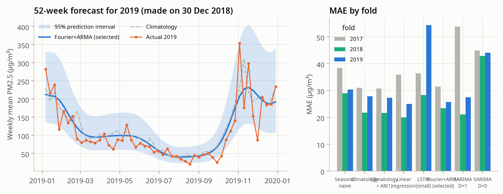
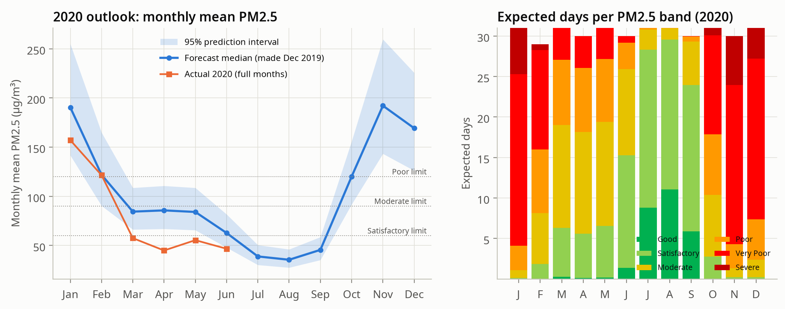
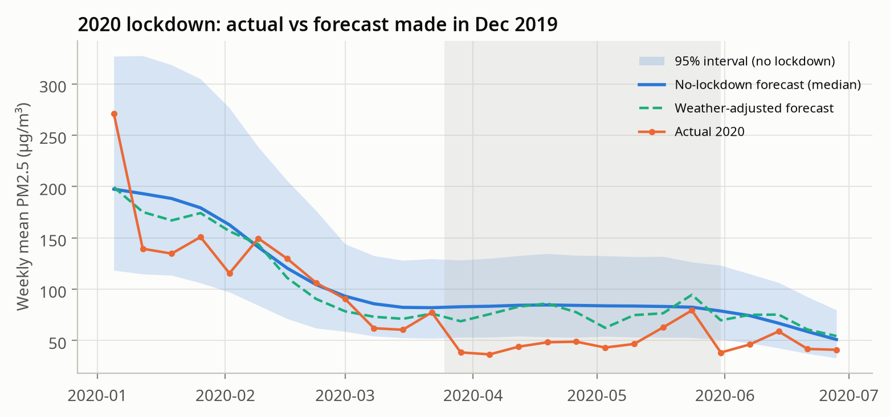

# Delhi PM2.5: Seasonality, Weather Predictability and a Rolling-Origin Forecasting Study

MATH F428 (Time Series Analysis), BITS Pilani, Goa.
**Authors:** Kushagra Singh, Yatin JM, Aryan Choudhary

Delhi's PM2.5 follows a very strong yearly cycle. This project asks two questions:

1. **Explain.** Do wind and humidity predict PM2.5, and over what horizon?
2. **Forecast.** How well can PM2.5 be forecast one week and 52 weeks ahead, and what does a model fitted before 2020 say about the 2020 lockdown?

The data end in July 2020, so this is a **historical forecasting study**: expanding-window backtests for 2017, 2018 and 2019, and a month-by-month outlook for 2020 made from data up to December 2019. It is not a current air-quality advisory.

## Key findings

| Question | Finding |
|---|---|
| Seasonality | Winter average 213 vs monsoon 48 µg/m³ (4.4x). Seasonal strength (STL) 0.90 on the 2015-18 weeks. A log transform removes the variance-level link (monthly spread 7.9x to 1.3x). |
| Does weather predict PM2.5? | Yes, over days. Wind and humidity anomalies Granger-cause PM2.5 (HAC Wald p about 6e-20 and 4e-11; still p < 1e-7 with rain and temperature controls, a trend, or a training-only climatology). A 1-SD wind shock changes PM2.5 by about -6 to -12% the next day, humidity by -4 to -7%. This is a predictive association, not proof of a physical effect. |
| Does it help at longer horizons? | No added value was detected at the weekly scale in the tested specification (nested test: ΔR² = 0.005, p = 0.51). One week ahead, last week's weather changes the error by -2.4%, the last three days by +0.7%, and the same week's weather (known only with hindsight) by +6.9% (p about 0.07). |
| 52-week forecasts | **Climatology is hard to beat.** MAE 2017 / 2018 / 2019: Fourier+ARMA 31.5 / 23.4 / 25.7 vs climatology 31.0 / 21.8 / 27.8, statistically indistinguishable. No model showed a convincing gain. SARIMA with seasonal differencing is unstable (53.8 in 2017); SARIMA D=0 and a small LSTM are clearly worse. |
| Prediction intervals | Raw 95% intervals covered 90% of 2019 weeks (94% in 2018, only 69% in the 2017 stress fold). Seasonal rescaling raises 2019 coverage to 96% but widens the intervals by about 43% and worsens the Winkler score (175 to 193): it buys coverage, not sharper intervals. |
| 2020 outlook | Validated on 2019: all 12 monthly means fall inside their 95% interval, but the share of Poor-or-worse days is over-predicted (55% vs 45%). |
| Lockdown | PM2.5 in the 10 weeks ending 29 Mar - 31 May 2020 was about 43% below the model's no-lockdown median (95% interval -52 to -32%). The model was already about 11% too high before the lockdown, so the gap is about 36% after adjusting for that; other level specifications give 37-51%, and a 2019 placebo gives -15% (interval spans 0). Descriptive, not a causal estimate. |
| Is the 2016-19 decline real? | Falls of about 25% (all stations), 20% (fixed 6-station panel) and 18% (weather-adjusted city series). Consistent with a genuine decline, but a monitoring-network effect is not ruled out (stations reporting rose from 8-10 to 37). |

Bands used for risk are **PM2.5 sub-index bands** (CPCB breakpoints), not the official multi-pollutant AQI.





## Data

| Source | Content | Period |
|---|---|---|
| CPCB via Kaggle [`rohanrao/air-quality-data-in-india`](https://www.kaggle.com/datasets/rohanrao/air-quality-data-in-india): `city_day.csv`, `station_day.csv`, `stations.csv` | Delhi daily PM2.5, NO2, SO2; station-level PM2.5 | 2015-01-01 to 2020-07-01 (2,009 days) |
| [Open-Meteo Historical Weather API](https://open-meteo.com/en/docs/historical-weather-api) (ERA5, 28.61N 77.21E) | wind, relative humidity, temperature, rain | same |

Two missing PM2.5 values were interpolated. The forecasting series is 287 weekly means (weeks ending Sunday, 2015-01-04 to 2020-06-28).

## Methods

1. **Cleaning and EDA** (`notebooks/01`, `02`): STL decomposition, log/Box-Cox justification, volatility, ADF and KPSS, level drift, and a station-network check. Headline statistics use the training years 2015-2018 only.
2. **VAR and Granger** (`notebooks/03`): VAR(4) on deseasonalised wind, humidity and log PM2.5 (day-of-year climatology, leap-year aware). HAC (Newey-West) Wald tests, rain/temperature/trend/season controls, Cholesky and generalised impulse responses, forecast-error variance decomposition, and a nested weekly lag test.
3. **Forecasting** (`notebooks/04`, `src/forecast.py`): three expanding-window origins (end of 2016, 2017, 2018), each forecasting the next 52 weeks, with every model refit and reselected using only data before the origin.
   - Models: seasonal naive, climatology, climatology + AR(1), linear regression, a small seeded LSTM, SARIMA (D=1 and D=0 with constant), and dynamic harmonic regression (Fourier terms + ARMA/ARIMA errors; Fourier order, error orders and level type chosen by AICc and an inner validation year).
   - Forecast point is the median `exp(mu)`; metrics include MAE, RMSE, bias, coverage and Winkler score.
   - Comparisons against climatology use a circular moving-block bootstrap (8-week blocks, within each forecast year). With only three origins, "indistinguishable" is the honest verdict for most models.
4. **Calibration and outlook**: seasonal rescaling of the predictive spread using earlier folds; 5,000 simulated weekly paths converted to daily values with whole within-week offset vectors (each week keeps its simulated mean), classified into PM2.5 bands. Monthly means and band-day counts come from the same daily paths.
5. **Lockdown case study**: actual weeks vs the no-lockdown projection, with an oracle-weather variant, a pre-lockdown bias adjustment, alternative level specifications and a 2019 placebo.

## Repository layout

```
data/raw/          city_day.csv, station_day.csv, stations.csv, delhi_weather_openmeteo.json
data/processed/    delhi_daily.csv, delhi_weekly.csv
src/               data.py, aqi.py, tsa.py (ADF/KPSS, climatology, week index),
                   forecast.py (models, backtest, metrics, simulation), plots.py
notebooks/         01_data_prep, 02_eda, 03_var_granger, 04_forecasting (executed, outputs saved)
results/           CSV/JSON tables; fc_* files belong to the forecasting study
figures/           PNG figures from the notebooks
slides/beamer/     main.tex (deck source), make_figures.py, verify_numbers.py, tables/
report/            report.tex (written report source)
tools/             build_nb04.py (regenerates notebook 04)
```

Useful result files: `fc_backtest_mae.csv` (MAE by model and year), `fc_loss_diff.csv` (bootstrap comparison with climatology), `fc_calibration_2019.csv`, `fc_oneweek.csv`, `fc_outlook_2020.csv` (monthly table), `fc_lockdown.csv` and `fc_lockdown_sensitivity.csv`, `granger_hac*.csv`, `station_check.csv`, and `key_numbers_*.json`.

## Reproduce

Python 3.12. Versions are pinned in `requirements.txt` (statsmodels 0.15.0, pandas 3.0.6, torch 2.14.1, ...).

```bash
uv venv --python 3.12 .venv && uv pip install --python .venv/bin/python -r requirements.txt

# raw data (needs a Kaggle API token); unzip the downloaded .zip files into data/raw/
for f in city_day station_day stations; do
  kaggle datasets download rohanrao/air-quality-data-in-india -f $f.csv -p data/raw
done

# notebooks (notebook 04 takes about 10 minutes; it sets OMP_NUM_THREADS=1 itself)
cd notebooks
for n in 01_data_prep 02_eda 03_var_granger 04_forecasting; do
  ../.venv/bin/jupyter nbconvert --to notebook --execute --inplace $n.ipynb
done
cd ..

# optional: regenerate notebook 04 from its builder first
python tools/build_nb04.py

# deck figures and slide numbers, number checks, then the PDFs (needs tectonic)
cd slides/beamer && python make_figures.py && python verify_numbers.py && tectonic main.tex
cd ../../report && tectonic report.tex
```

PDFs are not tracked in the repository (`*.pdf` is git-ignored); build them with the commands above.

`verify_numbers.py` re-derives selected numbers from the raw files and saved forecasts and fails on any mismatch. It covers the headline tables and macros, not every figure in the deck.

## Limitations

- **Few independent tests.** Three annual forecast origins cannot rank models; resampling weekly errors does not create extra test years.
- **2019 is not a pristine hold-out.** It was examined in earlier iterations of the project; selection and calibration in the code use only earlier data.
- **Level bias.** 2019 was cleaner than the training years; the forecasts over-predict, and calibrated interval scale factors differ by fold.
- **Interval width trade-off.** The rescaled intervals are wider and score worse on the Winkler score; the LSTM's intervals are an in-sample heuristic and optimistic.
- **Lockdown estimate** is model-relative and descriptive; the 10 Sunday-ending weeks cover 23 Mar - 31 May, and its size depends on the projected level.
- **Granger causality is predictive.** Boundary-layer height, stubble burning and fireworks are unmeasured; ERA5 is a single grid cell.
- **One city, changing monitor network.** The six-station check is small and thin in 2017.
- **SARIMA D=0 without a constant is numerically fragile** (AR root near 1); only the with-constant result is stable. Details are in `results/fc_sarima_d0_fit_details.csv`.
- **Simulation noise.** Simulated quantities (lockdown gap, band-day counts, interval bounds) vary by about 0.3 percentage points between re-runs.
- PM2.5 bands are not the official AQI.
